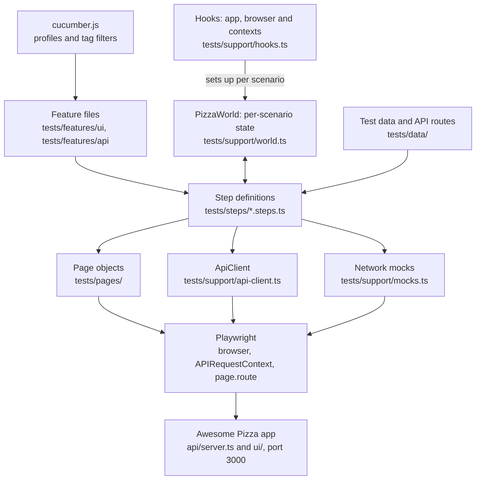

# Awesome Pizza API

A RESTful API for managing daily menu and pizza orders built with Express.js and TypeScript.

## Features

- **Daily Menu API**: Get the current pizza menu
- **Orders API**: Full CRUD operations for pizza orders
- **In-memory Database**: Fast development and testing
- **TypeScript**: Type-safe development
- **CORS Support**: Ready for frontend integration

## Getting Started

### Prerequisites

- Node.js (v16 or higher)
- npm or yarn

### Installation

1. Clone the repository
2. Install dependencies:
```bash
npm install
```

3. Start the development server:
```bash
npm run dev
```

The server will start on `http://localhost:3000`

### Scripts

- `npm run dev` - Start development server with hot reload
- `npm start` - Start production server
- `npm run build` - Build TypeScript to JavaScript

## API Endpoints

Interactive Swagger UI documentation is served at `http://localhost:3000/api-docs.html` while the server is running, and the raw OpenAPI 3.0 spec at `/swagger.json`. Both are static files in `ui/` (Swagger UI loads from a CDN, so it needs an internet connection). To call `/api/protected` or `/api/admin` from Swagger UI, log in with `POST /api/login` (`user` / `pass`), click **Authorize** and paste the token.

A [Bruno](https://www.usebruno.com/) collection in `bruno/` covers every endpoint, including error cases. Open the folder in Bruno, pick the **Local** environment and run the collection, or run it from the command line with `cd bruno && npx @usebruno/cli run --env Local`. Requests reuse the order and token created by earlier ones, so run the whole collection or a whole folder in order rather than single requests.

### Daily Menu

#### GET /api/daily-menu
Returns the current daily pizza menu.

**Response:**
```json
{
  "success": true,
  "data": [
    {
      "name": "Margherita Pizza",
      "description": "Classic pizza with fresh tomatoes, mozzarella cheese, and basil",
      "imageUrl": "https://example.com/margherita.jpg"
    }
  ],
  "message": "Daily menu retrieved successfully"
}
```

### Orders

#### GET /api/orders/:id
Get a specific order by ID.

**Parameters:**
- `id` (string) - Order ID

**Response:**
```json
{
  "success": true,
  "data": {
    "id": "order-001",
    "name": "John Doe",
    "status": "RECEIVED",
    "contents": [
      {
        "name": "Margherita Pizza",
        "quantity": 2
      }
    ]
  },
  "message": "Order retrieved successfully"
}
```

#### POST /api/orders
Create a new order.

**Body:**
```json
{
  "name": "Customer Name",
  "contents": [
    {
      "name": "Pizza Name",
      "quantity": 2
    }
  ]
}
```

**Response:**
```json
{
  "success": true,
  "data": {
    "id": "order-1698123456789-123",
    "name": "Customer Name",
    "status": "RECEIVED",
    "contents": [
      {
        "name": "Pizza Name",
        "quantity": 2
      }
    ]
  },
  "message": "Order created successfully"
}
```

#### PUT /api/orders/:id
Update an existing order.

**Parameters:**
- `id` (string) - Order ID

**Body (all fields optional):**
```json
{
  "name": "Updated Customer Name",
  "status": "DELIVERING",
  "contents": [
    {
      "name": "Updated Pizza Name",
      "quantity": 3
    }
  ]
}
```

**Response:**
```json
{
  "success": true,
  "data": {
    "id": "order-001",
    "name": "Updated Customer Name",
    "status": "DELIVERING",
    "contents": [
      {
        "name": "Updated Pizza Name",
        "quantity": 3
      }
    ]
  },
  "message": "Order updated successfully"
}
```

## Data Models

### Menu Entry
```typescript
type menu_entry = {
    name: string,
    description: string,
    imageUrl: string
}
```

### Order
```typescript
type order = {
    id: string,
    name: string,
    status: 'RECEIVED' | 'DELIVERING' | 'DELIVERED' | 'CANCELED'
    contents: {
        name: string,
        quantity: number
    }[]
}
```

## Order Status

Orders have four possible statuses:
- `RECEIVED` - Order has been received and is being prepared
- `DELIVERING` - Order is out for delivery
- `DELIVERED` - Order has been successfully delivered
- `CANCELED` - Order has been canceled

## Error Handling

All endpoints return standardized error responses:

```json
{
  "success": false,
  "error": "Error type",
  "message": "Detailed error message"
}
```

Common HTTP status codes:
- `200` - Success
- `201` - Created (for POST requests)
- `400` - Bad Request (validation errors)
- `404` - Not Found
- `500` - Internal Server Error

## Development

The API uses an in-memory database for simplicity. Data will be reset when the server restarts. For production use, consider integrating with a persistent database like PostgreSQL or MongoDB.

## Testing the API

You can test the API using tools like:
- Postman
- curl
- Thunder Client (VS Code extension)
- Any HTTP client

Example curl commands:

```bash
# Get daily menu
curl http://localhost:3000/api/daily-menu

# Get order by ID
curl http://localhost:3000/api/orders/order-001

# Create new order
curl -X POST http://localhost:3000/api/orders \
  -H "Content-Type: application/json" \
  -d '{
    "name": "Test Customer",
    "contents": [
      {"name": "Margherita Pizza", "quantity": 1}
    ]
  }'

# Update order status
curl -X PUT http://localhost:3000/api/orders/order-001 \
  -H "Content-Type: application/json" \
  -d '{"status": "DELIVERING"}'
```

## Test Framework Architecture

The repository holds the app under test and a BDD suite that tests it through both the browser and the REST API. Scenarios are written in Gherkin and run by [Cucumber.js](https://github.com/cucumber/cucumber-js). [Playwright](https://playwright.dev/) drives the browser, sends API requests and mocks network responses, and [axe-core](https://github.com/dequelabs/axe-core-npm/tree/develop/packages/playwright) runs the accessibility checks. Everything is TypeScript, loaded by `tsx`, so there is no build step.

### Layers



Each layer only talks to the one below it. The hooks sit alongside the layers: they start the app if it isn't already running, launch the browser, and give each scenario's World a fresh API and browser context. Feature files describe behaviour in plain language, step definitions translate each line into calls on page objects or `ApiClient` and make the assertions, and only page objects know how to find elements on a page.

| Layer | Location | Responsibility |
|---|---|---|
| Configuration | `cucumber.js` | Profiles (`default`, `smoke`, `api`, `ui`, `defects`, `all`, `ide`), tag filters, report formats, and loading TypeScript through `tsx/cjs` |
| Features | `tests/features/ui/`, `tests/features/api/` | Gherkin scenarios, one feature per area, named after the test case IDs in `specs/test-plan.md` |
| Step definitions | `tests/steps/` | One `<area>.steps.ts` file per area; `common.steps.ts` holds the generic ones. Steps stay thin and hold the assertions |
| World | `tests/support/world.ts` | `PizzaWorld`, created fresh for every scenario. Holds the page objects, API client, last response, created order and what the browser observed (console errors, failed requests, API calls). `interpolate()` expands `{orderId}`, `{loginToken}` and `{base64:…}` in feature text |
| Hooks | `tests/support/hooks.ts` | Starts the app and browser once per run, gives every scenario its own API and browser context, attaches a screenshot on failure, and handles the `@chromium-only` and `@skip-webkit` tags |
| Page objects | `tests/pages/` | `BasePage` holds the header, theme toggle and generic controls. `HomePage` composes `MenuSection`, `CartSection`, `OrderManagement` and `Notification`; `LoginPage` and `ProtectedPage` cover the other pages. Page objects never assert |
| API client | `tests/support/api-client.ts` | Typed wrapper over the REST API, used both by API scenarios and to set up data for UI scenarios |
| Mocks | `tests/support/mocks.ts` | `page.route` helpers that fake server errors, network failures and slow responses, so error paths can be tested without breaking the real server |
| Test data | `tests/data/test-data.ts`, `tests/data/api-routes.ts` | Every expected value, credential, message and API path, plus helpers such as `uniqueName()` and `resolveText()` |

### How a scenario runs

1. **Start-up:** `cucumber-js` reads the chosen profile in `cucumber.js`, which picks the feature files and tag filter. It then loads `tests/support/` and `tests/steps/`.
2. **Before all scenarios:** the hooks check whether the app answers at `BASE_URL`. If not, they start it with `SERVER_COMMAND` (by default `npx tsx api/server.ts`) and wait up to 30 seconds. They then launch the browser named by `BROWSER`, headless unless `HEADED` is set.
3. **Before each scenario:** Cucumber creates a new `PizzaWorld`. Scenarios tagged `@chromium-only` or `@skip-webkit` are skipped on the browsers they don't support. Every scenario gets its own Playwright `APIRequestContext` and `ApiClient`. Scenarios not tagged `@api` also get a new browser context and page, and the World starts recording console errors, failed requests and calls to `/api`.
4. **Steps:** each step reads and updates state on the World, acts through page objects or `ApiClient`, and asserts with Playwright's `expect`. Each step has a 30-second timeout.
5. **After each scenario:** if it failed, a full-page screenshot is attached to the report. The browser context and API context are then closed, so nothing leaks into the next scenario.
6. **After all scenarios:** the browser closes, and if the hooks started the app, they stop it.

### Tags

| Tag | Effect |
|---|---|
| `@ui`, `@api` | Area. `@api` scenarios run without a browser; the `ui` and `api` profiles select by these |
| `@P1`, `@P2`, `@P3` | Priority. The `smoke` profile runs `@P1` only |
| `@TC-…` | Test case ID from `specs/test-plan.md`, so a single case can be run with `--tags` |
| `@known-defect`, `@to-confirm` | The scenario asserts the correct behaviour for a known defect (D-1…D-7) or behaviour still to be confirmed. It fails until the app is fixed, so the default run excludes it and `npm run test:bdd:defects` runs it |
| `@visual` | Screenshot comparison against a stored baseline |
| `@chromium-only`, `@skip-webkit` | Skipped on browsers that can't run the scenario reliably |

### Design decisions

- **Isolation:** every scenario has its own browser context and API context. The app's in-memory data is shared by the whole run, so scenarios create their own orders with `uniqueName()`, treat the seeded orders (`order-001`…`order-003`) as read-only, and never assert on how many orders exist. Scenarios run one at a time by default, but this keeps them safe to run in parallel.
- **One browser per run:** `BROWSER` chooses Chromium, Firefox or WebKit for the whole run. CI runs Chromium only.
- **Defects stay visible:** known defects are recorded as failing scenarios rather than deleted or weakened, so fixing a defect is confirmed by its scenario starting to pass.
- **Error paths are mocked:** failures such as a 500 from `/api/daily-menu` or a dropped connection are produced with `page.route`, so the real server never has to be broken.
- **Visual baselines per platform:** screenshots are compared byte for byte against `tests/__screenshots__/<browser>/<platform>/`, because fonts and rendering differ between operating systems. A missing baseline is written on a local run but fails in CI, so CI can never pass without comparing.
- **No literals in steps:** values live in `tests/data/`, so a change to the app's text or routes is made in one place.

### Reports and CI

Each run writes `reports/cucumber-report.html` and `reports/cucumber-report.json`. Failed UI scenarios include a screenshot.

The GitHub Actions workflow in `.github/workflows/copilot-setup-steps.yml` runs on every push and can also be started manually. It installs the dependencies and Chromium, runs `npm run test:bdd`, and uploads the reports as the `cucumber-report` artifact, kept for 7 days. A manual run with `update_snapshots` ticked regenerates the Linux visual baselines and uploads them as the `visual-baselines-linux` artifact, to be committed to `tests/__screenshots__/chromium/linux/`.

### Related tooling outside the suite

- `bruno/` is a Bruno collection for manual and command-line API checks, and `requests.http` is the older VS Code REST Client version.
- `ui/swagger.json` is the OpenAPI spec behind the Swagger UI at `/api-docs.html`.
- `specs/test-plan.md` is the test plan: features, test case IDs and known defects.
- `playwright.config.ts` and `tests/seed.spec.ts` are Playwright Test scaffolding for the Playwright agents in `.claude/agents/`. The Cucumber suite doesn't use them.
- `.claude/skills/bdd-qa/` is the QA standard for working on this suite, mirrored in `.github/skills/` for Copilot.

## TypeScript Coding Standards

These describe how the existing `.ts` files are written. No linter or formatter is set up, so follow them by hand and match the file you are editing.

### Formatting

- 4-space indentation, semicolons, single quotes. The double-quoted seed data in `api/database.ts` is older code; use single quotes in new code.
- Use trailing commas in multi-line object, array and argument lists in test code.
- Short single-statement bodies can stay on one line (`if (x) return ...;`, `for (...) await ...;`).

### Modules and types

- Use named exports only, with no default exports (`playwright.config.ts` is the one exception because Playwright requires it).
- Import external packages first (`@cucumber/cucumber`, `@playwright/test`, Node built-ins), then local modules by relative path.
- Give exported functions and class methods explicit return types (`Promise<void>`, `Locator`, `Promise<boolean>`).
- Use string-literal unions for closed sets of values (`OrderStatus`, `mode: 'rejected' | 'network error'`), not `enum`.
- Use `unknown` for deliberately raw input (e.g. `createOrderRaw(body: unknown)`). Keep `any` to untyped JSON and browser globals.
- Shared API types live in `model/Model.ts` for the app and `tests/support/api-client.ts` for the tests.

### Naming

- Classes and types are `PascalCase` (`HomePage`, `PizzaWorld`, `OrderStatus`). The app model types `order` and `menu_entry` predate this, so leave their names as they are.
- Functions, methods, variables and properties are `camelCase`.
- Module-level constants and `static readonly` class constants are `UPPER_SNAKE_CASE` (`BASE_URL`, `PIZZAS`, `MenuSection.INCREASE`).
- Name files as follows: page objects `PascalCase.ts` (`MenuSection.ts`), step files `<area>.steps.ts`, everything else `kebab-case.ts` (`api-client.ts`, `test-data.ts`).

### Comments

- Put a one-line `/** ... */` on each class and on any method whose purpose isn't obvious from its name.
- Group related steps or methods under short `// Section` comments (`// Navigation`, `// Response checks`).
- Comments explain *why* (e.g. a browser quirk or a known defect), not what the next line does.

### API server (`api/`)

- Every response uses the envelope `{ success, data?, message?, error? }`.
- Validate input up front and `return res.status(4xx).json(...)` early. Wrap handler bodies in `try/catch` that returns a 500 envelope.
- Data access goes through the helpers in `api/database.ts` (`findOrderById`, `addOrder`, `updateOrderById`).

### Tests (`tests/`)

- **Step definitions** use `async function (this: PizzaWorld, ...)`, never arrow functions, because Cucumber binds the World to `this`. Keep steps thin and delegate to page objects or `ApiClient`.
- Use Cucumber expressions (`{string}`, `{int}`, `{word}`). Use a regex only for a fixed set of alternatives, e.g. `/^the Place Order button is (enabled|disabled)$/`.
- **Page objects** extend `BasePage` (full pages) or are plain classes (page sections). Declare `readonly` `Locator` fields and assign them in the constructor. Parameterised parts are methods that return a `Locator` (`card(pizza)`), and actions are `async` methods. Page objects never assert.
- **Locators:** use `getByRole` / `getByLabel` first, then element IDs or classes when there is no accessible name. Scope to a parent (e.g. a menu card filtered by its heading).
- **Assertions** live in steps and use Playwright's web-first `expect` (`toHaveText`, `toBeHidden`, `toHaveCount`). Use `expect.poll` for values that aren't locators. Avoid `waitForTimeout`; if one is unavoidable, add a comment saying why.
- **No hard-coded values in steps:** expected text, pizzas, credentials and messages go in `tests/data/test-data.ts`, and API paths go in `tests/data/api-routes.ts` (`API.*`).
- **State** for a scenario lives on `PizzaWorld`, not in module-level variables.
- **Isolation:** create your own orders with `uniqueName()`, treat seeded orders as read-only, and never assert on global order counts.
- **Setup helpers** that fail should throw an `Error` that includes the HTTP status and response body (see `ApiClient.createOrder`).
